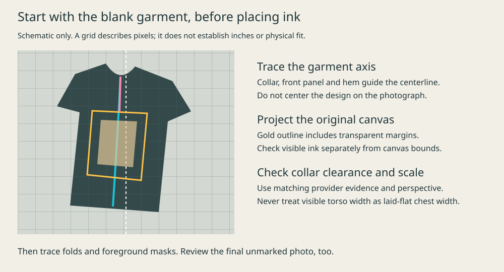

# Placement: evidence before confidence

Correct physical target metadata and a reproducible composite can still describe a visibly misplaced print. Review the rendered pixels against the garment, and keep centering, collar clearance, scale and foreground overlap separate.

## Establish the provider target

Use the original transparent artwork, saved provider product/variant, print-area dimensions, artwork transform and matching mockup. Keep full uploaded-canvas size separate from visible-ink bounds; transparent margins matter.

For a provider whose confirmed convention places image scale relative to print-area width, placed canvas width is scale × print-area width in inches, with height following the source aspect ratio. At confirmed pixels-per-inch, canvas inches are pixel dimensions divided by that value. Verify the provider's convention before applying the calculation. Normalized center coordinates inside a print area are not collar-to-ink distances.

Do not mix the print-area size of one garment variant with another variant's mockup. The maximum printable area does not say the design fills it. Use a provider photograph to establish the collar gap and panel relationship, while recording any unknown photographed size or styling distortion. A proposed product remains proposed until its actual saved placement or sample supplies the missing evidence.

## Mark the blank independently

Before inspecting the composite, mark the bottom of the front collar, several front-panel centerline points, visible sleeve-to-body/side seams and a useful lower-panel/hem point. Store source dimensions, crop and the coordinate space. Label inferred points and uncertainty rather than pretending hidden seams are measured.

On a turned torso, a simple midpoint between silhouette edges can be wrong. An arm, sleeve, fold, hair edge or unobstructed patch of cloth is not the body-panel boundary. Use collar, seams, fabric direction and torso rotation together. The annotation should reveal disagreement, not justify the existing ink.

## Four distinct decisions

| Check            | Evidence required                                                                                                                                                      |
| ---------------- | ---------------------------------------------------------------------------------------------------------------------------------------------------------------------- |
| Centerline       | The full artwork follows the front-panel axis through perspective/rotation; it is not centered on the frame or remaining visible cloth.                                |
| Collar clearance | The gap from the collar to the first ink agrees with the matching provider reference. Include the entire artwork, such as text, a speech bubble or a small top symbol. |
| Scale            | Visible ink and its original aspect ratio are consistent with saved target dimensions and panel landmarks. Treat differently framed images at their own scale.         |
| Occlusion        | Ink follows cloth and disappears behind real hands, hair, straps or folded-over fabric; masks follow actual foreground boundaries.                                     |

Each result is `pass`, `fail` or `uncertain` with a visible reason. No universal pixel gap or print-to-shirt ratio works across all framing, sizes and artwork shapes. Do not explain an offset away as “drape” without identifying the actual fold or rotation that supports it.

## Inspect the final files

Keep an annotated blank, final composite and provider reference side by side. For a replacement, include the original at the same framing. Inspect unmarked full-resolution detail and ordinary phone-sized display as well. Check that an apparent alignment fix did not move the ink into the collar or across hair.

Review all four checks after every edit. Bind the decision to both final PNG and JPEG hashes, plus the blank, artwork and placement record used. A review of a proposed quad or previous version is not approval of unseen pixels. Do not fall back to an older pass when a new audit is uncertain.

A reusable review record should contain: stable shot ID; selected exposure ID; reviewer; final hashes; identity/garment/provider reference paths or asset IDs; independently marked landmarks with coordinate space; four decisions/reasons; annotated evidence paths/hashes; and unresolved physical limits. The caller's gallery selector should reject missing, stale, failed or uncertain decisions. The compositor itself cannot provide visual approval.

## Resolve uncertainty without false precision

If important landmarks are hidden or sources conflict, obtain another independent review, improve the geometry evidence or make a clearer new exposure. Do not mark it passed merely because metadata numbers match. Keep known production uncertainty separate from visual judgment: a plausible mockup of a proposed product does not become a physically verified fit photograph.

## Reject stale or unresolved review records

The bundled [review gate](../scripts/verify-review.py) checks recorded decisions and file hashes. It cannot inspect a face, judge placement or verify that a reviewer actually looked. Fill the record only after the visual review; include each final file intended for delivery and the inspected comparisons. Paths are relative to the review JSON or absolute caller paths.

```json
{
  "schemaVersion": 1,
  "status": "approved",
  "reviewer": "Actual reviewer identity",
  "independent": true,
  "renderReceipt": { "path": "receipt.json", "sha256": "ACTUAL_RECEIPT_SHA256" },
  "checks": {
    "centerline": { "verdict": "pass", "reason": "Describe inspected front-panel landmarks." },
    "collarClearance": { "verdict": "pass", "reason": "Describe provider-relative gap." },
    "scale": { "verdict": "pass", "reason": "Describe target, perspective and uncertainty." },
    "occlusion": { "verdict": "pass", "reason": "Describe foreground inspection or why none crosses the print." }
  },
  "finalFiles": [{ "path": "full/photo.jpg", "sha256": "ACTUAL_SHA256" }],
  "evidence": [{ "path": "review/comparison.jpg", "sha256": "ACTUAL_SHA256" }]
}
```

Run `python3 /path/to/store-garment-photography/scripts/verify-review.py /path/to/review.json`. Add `--require-independent` when the workflow requires a second reviewer. Missing evidence, changed bytes or any unresolved check fails. The required render receipt binds selected final bytes to the rendered job and its blank, original artwork, texture and mask hashes. Include additional identity/provider comparisons in `evidence`; the gate cannot infer which evidence is visually sufficient. Only add verified final files to the selection; do not use the presence of some other approved file as clearance for an unlisted output. Passing this gate establishes a current record, not permission to publish.

## Make the geometry visible before polishing texture



This deliberately generic schematic contains no model or product artwork. On an actual photograph, use [placement-guide.py](../scripts/placement-guide.py) to make a separate diagnostic from the blank. It needs only the job's `blank`, `sourceCropBox` and `quad`; texture samples are not needed at this stage. Supply separately inspected landmarks in final 1200×1500 pixels:

```json
{
  "frontCenterline": [
    [610, 470],
    [600, 820],
    [570, 1250]
  ],
  "collarOuterBottom": [610, 470]
}
```

```sh
/path/to/photo-env/bin/python /path/to/store-garment-photography/scripts/placement-guide.py --job /path/to/job.json --landmarks /path/to/landmarks.json --output /path/to/new-guide.png
```

Use the isolated environment from [job-format.md](job-format.md). Crop coordinates follow the EXIF-oriented photograph. The guide adds a 120-pixel legend above the photo, making a 1200×1620 diagnostic; photo coordinates start at diagnostic pixel (0, 120). This keeps even top-edge collar landmarks visible. Numbers above are illustrative, not reusable placement. Cyan marks the traced garment axis, gold the full unbent artwork canvas, pink the collar-to-canvas gap, and white the photograph's center. A 100-pixel grid is not a physical ruler. Transparent margins mean the visible ink may begin below the gold edge. Save a final ink overlay too, and inspect the unmarked image: a convincing rectangle cannot rescue misplaced artwork.

Establish this geometry before repeated detailed renders. If collar/front-panel landmarks are hidden or disagree, obtain a clearer blank or evidence instead of trying many arbitrary translations. A reviewed proposal can be useful, but do not call it verified production placement.
